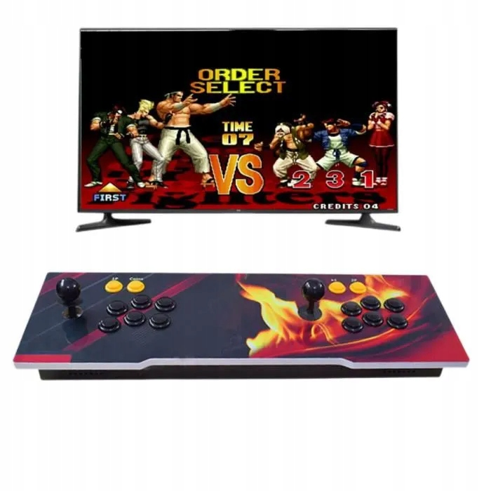

# Pandora Box 9S Unlock

Research notes and tools for moving one Allwinner H3 Pandora Box 9S to a larger microSD card, retaining its original menu and game launch flow, and cleaning up its game catalog.

**Working on the tested console:** booting from a replacement 128 GB card, a 3,318-entry alphabetically ordered library, and the P1+P2 category menu. The owner confirmed the final history fix on real hardware on **19 October 2026**.

Product photo: [original Allegro listing, offer 17882745452](https://allegro.cz/produkt/26800-w-1-pandoras-box-9s-retro-video-arcade-station-konsola-do-tv-pc-ps3-cadee56d-e0e5-4a6b-8f29-ddbc706e31d0?offerId=17882745452). Photos belong to their respective rights holders; see [image sources](docs/images/README.md).

## What “unlock” means here

The vendor menu checks the SD card identity. Copying the original image to a different card produced a running system with a black screen because the menu repeatedly crashed during that check.

The working solution preserves the card's original reserved data and makes a small `LD_PRELOAD` library return the **application-visible** identity expected by this firmware. These values can differ from the physical card registers read over SPI. This does not rewrite the replacement card's hardware CID. It is a per-card compatibility approach, not a universal key or a firmware-independent bypass.

This public repository contains the method and parameterized source. Actual card identity values and the exact working recovery files belong in a separate private repository. Do not publish generated headers, compiled profile-specific shims, logs, or firmware dumps.

## Start here

1. [Hardware and storage layout](docs/hardware.md)
2. [Backup, identity diagnosis, and larger-card setup](docs/unlock.md)
3. [Game catalog, alphabetical sorting, and the history crash](docs/catalog.md)
4. [Validation and troubleshooting](docs/validation.md)
5. [Tools and dependencies](docs/tools.md)

The tested software stack is vendor Linux 3.4.113, ARMv7, glibc 2.25, and a modified SquashFS format. Units with the same retail name can have different internals. Start with a complete image of your own card and keep the original card untouched.

## Included tools

| Area | Files |
|---|---|
| Identity | `src/cardspoof.c`, `src/cardprobe.c`, `tools/make_identity.py` |
| Physical SD registers | [ESP32 Arduino reader and wiring](arduino/README.md), CID/CSD/OCR/SCR |
| Runtime | `runtime/autorun.sh`, `tools/patch_init.py`, `tools/build_p2.py` |
| Filesystem | `tools/pandsq.py`, `tools/sqwrite.py`, `tools/extract_region.py` |
| Catalog | `tools/clean_db.py`, `tools/families.py`, `tools/unique_db.py`, `tools/sort_db.py` |
| Recent list | `tools/reset_history.py` |
| Compiler | `toolchain/Dockerfile` |

These are small research tools, not a one-click flasher. No ROMs, game previews, vendor executables, complete firmware images, or card-specific identity values are distributed here. The filesystem and database tools operate on your own local files.

## Status and limits

- The deployed, card-specific shim and normal menu/game loop were verified on the actual console.
- Alphabetical order and P1+P2 navigation were also confirmed by the owner.
- ARM/QEMU tests ran the vendor identity check and reproduced the category crash with old recent-game entries. Replacing only that list made the category menu render successfully.
- Public templates have been generalized from those working files. Building them requires your own application-visible profile and original firmware. They are not additional hardware-tested builds for arbitrary 9S units.
- Catalog cleanup rules are specific to the observed database. Review them before applying them to another release.

See [validation](docs/validation.md) for the evidence and what has not been tested. Project code is [MIT licensed](LICENSE); third-party photographs are excluded.
