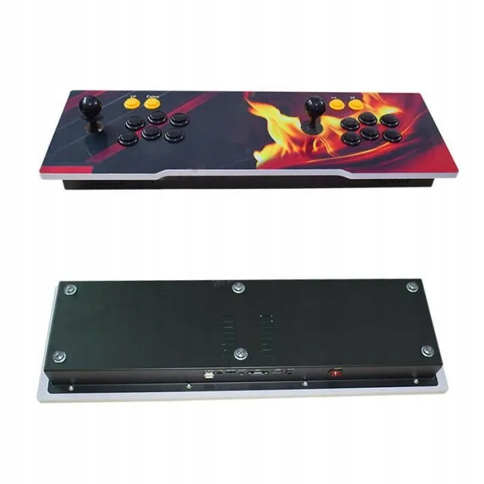
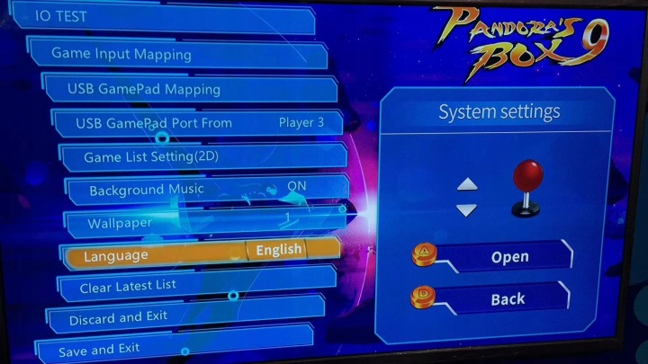

# Tested hardware

The original product listing identifies a two-player **Pandora Box 9S**, advertised with 26,800 games, HDMI, VGA, and USB. The photographs below originate from the Allegro listing used to identify this model; they are not photographs of the opened board.

## Observed inside this unit

| Component | Observation |
|---|---|
| SoC | Allwinner H3, ARMv7 |
| RAM | 256 MB, observed by the system |
| OS | Vendor Linux 3.4.113 |
| C library | glibc 2.25 |
| Display resources | 1280 × 720 |
| Original system data | Modified, zlib-compressed SquashFS |
| Replacement card | Nominal 128 GB, FAT32 data partition |

The original image used a small FAT boot partition, a roughly 200 MB root filesystem, and a large data partition containing another filesystem image named `roms` plus configuration and resources. The replacement layout keeps the vendor boot stack, reserves 512 MiB for P2, and uses FAT32 for P3 with loose files under `sdcard/`.

## Replacement layout used in this project

| Region | Start sector (512 bytes) | Length / purpose |
|---|---:|---|
| MBR, bootloader, reserved data | 0 | Preserve from the owner's original image, except partition-table entries |
| P1: vendor boot | 4096 | 20,480 sectors; preserved |
| P2: vendor rootfs | 24,576 | 1,048,576 sectors (512 MiB slot) |
| P3: PANDORA / FAT32 | 1,073,152 | Remainder of replacement card |

P3 starts at byte offset **549,453,824**. Windows drive letters and physical disk numbers are not stable identifiers. The exact replacement capacity is kept in the owner's private profile; public templates require it as an input.

The sectors read by the identity routine in this firmware were 2039, 2041, and 2043. They remained identical to the original backup. Do not replace them with data from someone else's card.

## Controls

The observed input mapping uses bit 2 for P1 Start and bit 13 for P2 Start. Pressing P1+P2 opens the category/index screen; its initial selection was **Recent**. The first player's directional bits are 3–6, followed by buttons 7–12. Second-player directions are 14–17 and buttons 18–23.

These mappings came from this kernel and console. They do not establish a universal wiring scheme for every product sold under the same name.
